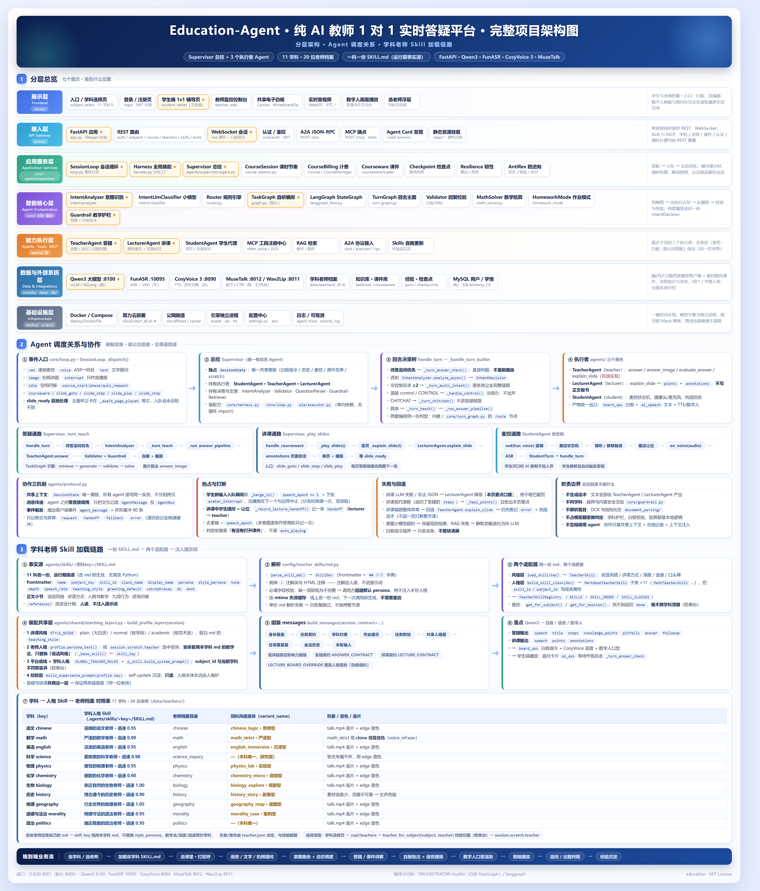
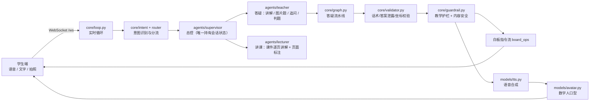

# education · 纯 AI 教师 1 对 1 实时答疑系统

<p align="center">
  
  
  
</p>

一套全流程无人值守的 1 对 1 线上辅导系统：学生通过语音、文字或拍照提问，AI 教师以数字人形象实时讲解、板书、追问、出题和判题。不配置任何密钥也能跑通主链路——所有模型和外部服务都是可插拔的，缺失时自动降级为 Mock 或占位实现。

- **模型栈**：Qwen3（大脑）/ FunASR（听）/ CosyVoice 3（说，可克隆音色）/ MuseTalk（对口型）
- **产品形态**：学科选择页 → 1v1 辅导页（默认 40 分钟一节课）→ 总结答疑
- **覆盖学科**：语文、数学、英语、科学、物理、化学、生物、政治、道德与法治、地理、历史，共 11 科（小学·初中）

---

## 这个项目解决什么问题

### 面向的场景与痛点

本项目面向中小学学生的**课后答疑与学科辅导**场景。学生在做作业、订正试卷或复习时遇到难题，常见的解决路径都存在明显缺口：问家长，家长未必讲得出或讲得透；等到第二天再问老师，学习节奏已被打断，问题也容易遗忘；请一对一家教，则价格高、时段受限，且师资质量参差不齐。线上真人一对一辅导虽然缓解了师资与地域的限制，但并没有消除「教师必须全程在线投入」这一根本约束，因此无法把高质量一对一辅导带到足够低的价格和足够广的覆盖。

本项目要解决的正是这一矛盾：**让一名「始终在线、讲解稳定、可无限复制」的 AI 教师，完成原本必须由真人承担的一对一实时答疑与辅导。**

### 真人一对一辅导的供给矛盾

真人一对一之所以难以规模化，根源在于四组刚性约束：

1. **服务能力与人力线性绑定**。一对一教学要求教师全程在线、逐题讲解、即时反馈，教师的授课时长与其精力严格成正比。要服务更多学生，就必须按比例增加教师人力，边际成本不随规模下降。
2. **优质师资的时空集中**。能否请到好老师，取决于学生所在的地区与可配合的时段，优质一对一资源天然稀缺且分布不均。
3. **教学质量依赖个体状态**。同一道题在不同教师、不同课次之间的讲解深度、追问节奏与板书组织难以保持一致，教学效果随教师状态波动。
4. **面向未成年人的合规监督难以逐句覆盖**。真人授课的每一句输出都依赖事后抽查，无法在大规模场景下做到逐句审核。

### AI 数字人教师的对应解决方式

针对上述约束，AI 数字人教师给出的是一组工程化的、可执行的回应：

- **服务能力按算力横向扩展**。AI 教师的核心推理与渲染以计算资源为约束而非以人力为约束；每条连接对应一个独立的会话状态，扩容表现为增加算力，而非线性增加教师人力。
- **随时开课，学习节奏归学生**。学生可在任何时间发起提问并立即获得讲解，不再受制于教师课表。
- **教学质量由机制保证一致**。学科人格、讲课深度、语速、追问节奏与板书组织集中定义于学科技能文件（`.agents/skills/<学科>/SKILL.md`），提问分流由意图决策层统一判定，讲解结果再经回复校验（`core/validator.py`）与数学验算（`core/math_solver.py`）复核；教师还能在答疑结束后异步复盘、沉淀可复用的教学经验注入后续讲解（`SKILL_SELF_UPDATE_ENABLE`）。由此，「同一位老师」的讲解标准在每节课中保持稳定，且随使用不断优化。
- **合规边界内建且每次必经**。学科与学段范围限定、输出内容安全过滤、AI 生成内容标识被实现为每次输出都必须经过的处理环节（`core/guardrail.py`），而非依赖事后人工抽查。

### 为什么必须是「真人形象数字人」，而非纯语音或纯文字

一对一教学的效果不仅取决于讲得对不对，也取决于学生是否持续投入注意力。真人形象的实时画面能提供接近面对面辅导的临场感：教师讲解过程中的点头、摇头、摊手、指向等动作，以及答对时的点头表扬、答错时的鼓励反馈，都会直接影响低龄学生的参与意愿。纯文字或纯语音缺少这层表达性，难以维持低龄学生的注意力。

因此本项目在语音播报之外引入**口型与教师形象同步的数字人教师**：教师形象来自真人底片视频，口型与手势由模型按音频实时驱动（MuseTalk 等），使「AI 在对我讲话」转化为具有表达性的教学互动。形象自然度高，且**更换教师只需替换底片素材与音色，无需改动任何代码**。

### 为什么「实时」是硬性前提

答疑场景对延迟极为敏感：学生提问后若需等待数秒才开始讲解，学习注意力即被中断。因此系统的端到端链路必须尽可能流水线化——流式大模型生成、逐句语音合成、逐句口型渲染，并在学生开口讲话时主动让出话语权、允许随时插话打断。项目为此设定了明确的延迟目标（语音响应 1.2 秒、音画同步 300 毫秒、白板同步 120 毫秒），并围绕这些目标设计了流式生成、逐句合成、逐句渲染与预取流水线，以及**智能麦控**（学生开口时 AI 静默倾听、不抢话，静默后自动触发答疑，支持 barge-in 插话打断）。

### 本项目的定位取舍

需要明确的是，本系统聚焦于**一对一实时答疑与辅导**，而非大班直播课或录播课程。产品形态为：页面上方呈现 AI 教师数字人形象与学生端实时画面，下方为双方共享的电子白板；学生的提问形式包括语音连麦、文字输入与拍照上传，AI 教师完成讲解、板书、追问、出题与判题，全流程无需真人介入。

---

## 功能特性

### 学生端

- **学科选择入口**：11 个学科卡片，部分学科提供多种风格的老师（如 `math` / `math_strict`），点开后浮层选择
- **40 分钟辅导课**：教师主动打招呼 → 问候热身 → 知识点讲解 → 互动出题 → 总结答疑，页面带倒计时与阶段条
- **多模态提问**：语音连麦（智能麦控）、文字消息、拍照上传试卷/习题到共享白板
- **实时画面**：主区为共享白板，右侧上方是 AI 教师数字人形象（待机静态形象、讲解时播放对口型视频），下方是学生自己的摄像头画面；摄像头/麦克风可手动开关（需 HTTPS 或 localhost 安全上下文）
- **白板同步**：实时看到 AI 的批注、书写、圈画和解题步骤
- **课件讲解**：打开 PPT 课件后 AI 逐页讲解，并在页面上圈画/高亮标注

### AI 教师（全流程无人值守）

1. **智能麦控对话**：学生开口时 AI 静默倾听不抢话，静默后自动触发答疑；支持 barge-in 插话打断（`agents/shared/mic_control.py`）
2. **自主白板答疑**：自行输入文字、绘制图形、画笔批注、橡皮擦（`agents/shared/whiteboard.py`）
3. **图片题目讲解**：OCR 识别题目区域 → 圈画标注 → 拆解步骤 → 书写答案
4. **追问与出题判题**：讲完题主动追问，按「概念→方法→步骤→答案」分层引导，带追问与重试上限防死循环；辅导课模式下按节奏生成模拟题（**优先从教研真题库选题**，库不可用自动回退 LLM 即兴生成，`core/exercise_bank.py`），答对表扬（点头+⭐）、答错讲解
5. **作业助学模式**：把「一道题的答疑」升级为「一份作业的助学流程」——按题推进、逐层放开提示（先启发概念 → 给方法 → 给步骤 → 最后才给答案）、判定对错并串联错题本（`core/homework_mode.py`、`core/hint_homework.py`）
6. **讲解重点标红**：模型以 `**...**` 标记讲解中的重点片段，白板与聊天文字渲染成红色强调；语音播报前自动剥离标记，前端只拼 DOM 节点、不用 innerHTML（`agents/shared/emphasis.py`）
7. **表情贴纸反馈**：学生答对时由 LLM 判定情境（一般答对 / 表现出色），随回复下发对应表情包与表扬话术（`core/skills/expression_skill.py`，`AVATAR_EXPRESSION_ENABLE`）
8. **数字人实时口型**：TTS 音频驱动视素时间线，可接 MuseTalk 渲染服务输出真人形象对口型视频（`models/avatar.py`、`core/viseme.py`）
9. **空闲主动问候**：学生静默一段时间后 AI 主动搭话（`IDLE_NUDGE_*`）
10. **教师经验自我更新**：回合结束后异步复盘，沉淀可复用的教学经验注入后续提示词（`SKILL_SELF_UPDATE_ENABLE`），只追加经验条目、不改写人格本体
11. **自主工具调用与 ReAct 闭环**：模型可自行查教材、解方程、复核答案、读题与回看白板，走「思考 → 行动 → 观察」闭环后再开口（`agents/shared/toolkit.py`、`agents/teacher/react.py`，`AGENT_TOOLS_ENABLE` / `AGENT_REACT_ENABLE`）
12. **回合自主规划**：开口前先由模型产出「目标 + 步骤 + 建议工具」，超时回退规则计划（`core/planning/`，`AGENT_PLANNER_ENABLE`）
13. **学情长期记忆**：跨会话记住这位学生的错题、薄弱点与偏好，下次讲解时自然带出；按学生物理隔离，支持整份删除（`core/memory/`，`MEMORY_ENABLE`）

### 安全与合规（面向未成年人）

- 学科/学段范围限定、输出内容安全过滤、AI 生成内容标识，实现为每次输出必经的处理环节（`core/guardrail.py`）
- **三级处置口径**（`core/guardrail.py`）：危机信号走专线、不当用语遮蔽、教学内容敏感只标记 —— 物理课的「滚动摩擦」不会被打成「\*\*动摩擦」，道法课讲「赌博的危害」也不会被误伤
- **危机信号专线**（`core/safety_gate.py`）：学生表达自伤/自杀意念时**不答疑、不追问、不评判**，只做关怀 + 求助引导，并推 `crisis_alert` 给在场的人
- **安全事件落盘审计**（`core/safety_audit.py`）：`push_event` 只到当前连接，没人在线就等于没上报；危机干预必须可追溯，每条事件带原文、命中词、会话与学生 id，教师端监控台 15 秒轮询展示
- **安全网关是挂载点而不是工具**：学生输入（`handle_turn` 入口）、AI 话术、白板文字、**流式话术**、分步解析、追问文本全部必经此处 —— 护栏一旦能被绕过，它就不是护栏
- 接口限流与防逆向签名（`core/anti_rev.py`）
- 会话检查点支持断线续聊；教学过程（白板指令流、智能体协作轨迹）可记录回放；节点级图执行轨迹可落盘排障（`core/activity_log.py` + `scripts/view_activity.py`，`ACTIVITY_LOG_ENABLE`，默认关闭）

### 可观测与质量治理（云端融合合入）

- **回合调用链日志**（`core/trace.py`）：每次学生输入多打一条日志，列出经过哪些函数、各花多少毫秒，缩进表示层级（`TRACE_ENABLE`）
- **回合裁决落盘**（`core/verdict.py`）：把 JSON 降级 / 质检扣分 / 调用链异常 / 总耗时追加进当天 JSONL。采集点是 `handle_turn` —— **所有分支的唯一收口点**
- **健康诊断**（`core/health.py`）：四维画像 + 与前一窗口对比的退化结论，带三条防误报规则（样本 <20 不判断、变化太小不报、学科离群单独提示）
- **失败聚类**（`core/failure_cluster.py`）：把「一批失败」压成可追的缺陷签名（主原因 @ 卡住的那一步），而不是四张互不相干的频次表
- **经验层 L2/L5**（`core/skills/experience/`）：按**实测收益**的后验采样决定注入哪几条（bandit），裁决回写经验战绩；人工抽检台按**风险**而非时间排队
- **回归门禁**（`evals/` + `scripts/eval_agent.py`）：走真实生产链路（不是 Mock）跑 12 题 9 学科，规则分 + 裁判分双层打分，基线对比容差 3 分。单元测试守不住提示词级别的退化，这一层才能
- **日志落盘**（`config/logging.py`）：stderr + `logs/app.log`，按天轮转 + 时长/份数/总量三重保留

---

## 快速开始

### 环境要求

| 项 | 要求 |
| --- | --- |
| Python | 3.10+ |
| 操作系统 | Windows（本机脚本为 PowerShell）/ Linux（云端为 bash） |
| ffmpeg | 可选。音色克隆抽取参考干声、数字人合流时需要 |
| GPU | 可选。MuseTalk 数字人引擎与本地 Qwen3 需要 CUDA |
| MySQL | 可选。用于用户/学情存储与真题出题（`ai_teacher` 库）；连不上时登录注册与真题出题分别降级，教学链路不受影响 |
| bge-m3 / Milvus / Redis | 可选。`rag/online` 检索增强问答运行时的重依赖；缺失时该链路不启用，主链路不受影响 |

### 安装

```bash
# 方式一（推荐）：可编辑模式安装，附带 education-server / education-demo / education-mcp 命令
pip install -e .

# 方式二：仅安装依赖
pip install -r requirements.txt

# 一次性带上全部可选依赖
pip install -e ".[vision,ocr,langgraph,digitalhuman,dev]"
```

可选依赖缺失时系统自动降级，不影响启动：

| 扩展 | 内容 | 缺失时的降级 |
| --- | --- | --- |
| `vision` | `mediapipe>=0.10,<0.11` / `opencv-python` | 跳过底片人脸校验与检测 |
| `ocr` | `paddleocr` / `paddlepaddle` | 使用 `MockOCRClient` |
| `langgraph` | `langgraph>=0.2` | 回退自研 TaskGraph |
| `digitalhuman` | `pypinyin` / `imageio-ffmpeg` | 前端回退能量驱动口型；数字人回退照片木偶 |
| `dev` | `pytest` / `pytest-asyncio` / `ruff` | 仅开发测试需要 |

> ⚠️ `mediapipe` 必须用 0.10.x（1.0.x 移除了 `mp.solutions` 经典 API）。Python 3.12 下 `mediapipe`/`paddle` 可能装不上，让 OCR 走降级即可跑通全链路。

### 配置

```bash
cp .env.example .env      # Windows PowerShell: Copy-Item .env.example .env
```

**所有模型项留空即自动 Mock 降级**，不填任何密钥就能跑通全链路。真正部署时重点覆盖：

- `LLM_API_KEY` / `LLM_API_BASE` / `LLM_MODEL`（大脑）
- `ASR_*` / `TTS_*` / `COSYVOICE_API_BASE`（听说）
- `DATABASE_URL`（用户库）、`AUTH_SECRET`、`ANTI_REV_SECRET`（**必须替换默认值**）
- `CORS_ALLOW_ORIGINS`（默认 `*`，生产应收窄）

配置项的完整说明见 [`.env.example`](.env.example)，常用分组见下文「配置说明」。

### 运行

```bash
# 离线演示：不依赖任何密钥，跑通「路由 → 答疑 → 麦控」全链路
python -m scripts.run_demo

# 启动实时服务（终端会打印可点击的访问地址）
python -m server.app
```

启动后的页面入口（端口以 `.env` 的 `PORT` 为准，默认 8000）：

| 路径 | 说明 |
| --- | --- |
| `http://127.0.0.1:8000/` | 学科选择页（根路径，选学科后进入 1v1 辅导） |
| `http://127.0.0.1:8000/app/student_tablet/` | 直达 1v1 辅导页（不带 `?subject` 则退回答疑模式） |
| `http://127.0.0.1:8000/app/login/` | 登录/注册页 |
| `http://127.0.0.1:8000/app/teacher_web/` | 教师监控控制台 |
| `http://127.0.0.1:8000/docs` | Swagger 交互式接口文档 |

---

## 部署

### Docker

```bash
docker compose -f deploy/docker-compose.yml up --build
```

`deploy/Dockerfile` 基于 `python:3.11-slim`，装好 `libglib2.0-0 libgl1 ffmpeg`，暴露 8000 端口；compose 单服务 `education`，读取根目录 `.env` 并挂载 `data/`。

### 算力云全栈（Linux）

```bash
bash deploy/cloud/check_gpu.sh          # 0) GPU 自检
bash deploy/cloud/setup.sh              # 1) 基础环境 + 虚拟环境
bash deploy/cloud/download_models.sh    # 2) 克隆仓库 + 下载权重
bash deploy/cloud/start_all.sh          # 3) 一键启动全栈
bash deploy/cloud/stop_all.sh           # 停止全部
bash deploy/cloud/pause.sh              # 一键停止（含公网隧道），之后可放心「关机/停止」
bash deploy/cloud/restart_app.sh        # 只重启主应用（引擎不动）
bash deploy/cloud/restart_tts.sh        # 只重启 CosyVoice TTS 引擎
bash deploy/cloud/resume.sh             # 关机后一键恢复（含 cloudflared 隧道，输出公网链接）
bash deploy/cloud/switch_mode.sh offline   # 切换答疑大脑：online(API) / offline(本地模型)
```

云端全栈的端口约定：主应用 8001、Qwen3（vLLM）8100、FunASR 10095、CosyVoice 8090、MuseTalk 引擎 8012。详见 [`md_docs/算力云部署.md`](md_docs/算力云部署.md) 和 [`md_docs/服务器环境与迁移清单.md`](md_docs/服务器环境与迁移清单.md)。

### 桌面客户端（可选）

`desktop/` 是一个 Electron 壳，加载远程课堂页，可打包为 Windows 客户端：

```powershell
cd desktop
npm install
npm start            # 本地试运行
npm run build        # 打包 .exe -> desktop/dist/
```

---

## 技术架构

<p align="center">
  
</p>
<p align="center">
  <sub>完整项目架构图：分层总览 · Agent 调度关系与协作 · 学科老师 Skill 加载链路（可交互源文件见 <a href="docs/architecture.html">docs/architecture.html</a>）</sub>
</p>

### 整体数据流



编排引擎可切换：`ORCHESTRATOR=builtin`（自研 TaskGraph，默认）或 `langgraph`（LangGraph StateGraph），两条链路的行为一致性由 `tests/test_graph_parity.py` 保障。讲解口径也有三档：标准管线（默认）/ 流式（接数字人时话术边生成边逐句播报）/ 白板先行（`BOARD_FIRST_MODE=single_call|two_call`，先把题意理解写上板、再给最终解答）。

### 智能体分工

智能体按**职责**切分，不按学科——学科差异由 `.agents/skills/<学科key>/SKILL.md` 一份 Markdown 承载（frontmatter 给风格/深度/语速，正文给人格与教学行为，运行期现读现改现生效）：

| Agent | 角色 | 负责 | 不负责 |
| --- | --- | --- | --- |
| `core.intent.IntentAnalyzer` | 决策层 | 会话入口闸门：判意图、标「复杂/多意图」、决定转交 | 具体讲解内容 |
| `TeacherAgent` | teacher | 答疑：讲题、图片题、白板书写、追问判定、出题判题 | 课件逐页讲解 |
| `LecturerAgent` | lecturer | 讲课：课件逐页话术、页面圈画/高亮 | 答疑、正文板书 |
| `Supervisor` | supervisor | 唯一持有会话状态：调用顺序、抢占、异常回退 | 具体讲解内容 |
| `StudentAgent` | student | 学生端代理（麦控/设备状态） | — |

Agent 之间不直接互相调用，通过共享上下文（`SessionState`）、消息（`AgentMessage`/`AgentBus`）和事件（`agent_message`）三种机制协作，协作轨迹可回放。调度策略全貌见 [`docs/supervisor_orchestration.md`](docs/supervisor_orchestration.md)。

**自主性四层**（工具调用 / 自主规划 / ReAct 闭环 / 长期记忆）：编排仍是确定性的（谁在什么时候干什么写在 `Supervisor` 里），但**内容生产这一层交给了模型自己拿主意** —— 要不要查教材、要不要先解方程复核、这题该怎么拆、这位学生上次错在哪。四层都可独立关闭，全关即回到「单次生成 + 规则分流」的原始链路。详见 [`docs/agent_autonomy.md`](docs/agent_autonomy.md)。

### 技术栈

本项目的技术路线可以概括为「**模型能力可插拔、外部依赖可降级**」：所有模型与外部服务都通过统一接口接入，未配置密钥或依赖缺失时自动切换到 Mock 或占位实现，保证在任何环境下都能完整跑通「提问 → 答疑 → 白板」主链路。下表先给一张总览，随后逐领域说明在本项目中的角色与选型理由。

#### 总览

| 领域 | 方案 |
| --- | --- |
| 语言与服务 | Python 3.10+ / FastAPI / Uvicorn / WebSocket（`/ws` 统一承载事件、白板指令与媒体下发） |
| 前端 | 原生 HTML / Canvas / JS（`clients/`，零构建、与服务同源） |
| 大模型 | OpenAI 兼容协议 / Qwen3 私有化（vLLM / SGLang）；视觉理解走 VLM（`VLM_MODEL`） |
| 实时语音 | FunASR（ASR + VAD）/ CosyVoice 3（兼容 2）/ GPT-SoVITS / edge-tts |
| 数字人 | MuseTalk v1.5（云端在用）/ LatentSync 适配；无引擎时回退视素时间线或照片木偶 |
| 编排 | 自研 TaskGraph（默认）/ LangGraph StateGraph |
| OCR | PaddleOCR（缺失自动 Mock） |
| 数学验算 | SymPy 独立求解复核（可选，未装则自动跳过），弥补大模型心算不可靠 |
| 知识检索 | 主链路用 `rag/retriever.py`（字符 bigram，无向量库依赖）；另有 `rag/offline`（数据构建流水线）与 `rag/online`（bge-m3 + Milvus + Redis 的检索增强问答运行时，重依赖独立链路） |
| 出题与作业助学 | 教研真题库优先选题（`core/exercise_bank.py`）；作业模式分层提示 + 错题本（`core/homework_mode.py`） |
| 存储 | MySQL（SQLAlchemy 2.0：用户/监护关系；真题库 `ai_teacher` 只读）+ JSON/JSONL 文件（检查点、学情记忆、教师经验、课时账单、活动日志） |
| 协议互操作 | MCP（stdio + Streamable HTTP）、A2A（Agent Card + JSON-RPC 2.0） |
| 数字人子服务 | `digital_human/` 独立服务（aiortc WebRTC 推流，:8010，默认关闭） |
| 测试与质量 | pytest / pytest-asyncio / ruff |

#### 选型原则

- **模型能力可插拔**：LLM / ASR / TTS / 数字人四类能力各自抽象为统一接口（`models/base.py`），通过环境变量切换 provider，替换供应商或切换到私有化部署时无需改动上层代码。
- **外部依赖可降级**：所有外部依赖（模型、OCR、数字人、SymPy、数据库、RAG）都以「缺失即降级」为默认行为，任何一项不可用都不阻断教学主链路。
- **分层清晰、边界单一**：代码按「接入（`server/`）→ 编排与决策（`core/`）→ 智能体（`agents/`）→ 能力（`models/`）」分层，上层不直接实例化下层实现。
- **对外协议标准化**：工具能力走 MCP，智能体互调走 A2A，均可被标准客户端直接接入。
- **前端零构建**：前端以原生 HTML / Canvas 实现、与服务同源，无需构建流水线；所有网络地址为相对路径，任何域名或隧道下均可直接运行。
- **以 Markdown 与配置为事实源**：教师人格与风格由 `.agents/skills/<学科>/SKILL.md` 承载，配置集中在 `config/settings.py` 与 `.env`，运行期现读现改现生效。

#### 运行时与配置

- **Python 3.10+**：全栈实现语言。选择它的原因是异步生态成熟、与推理栈（torch、MediaPipe、Paddle）兼容性好，且 3.10 起的结构模式匹配与改进的类型标注能显著提高长链路代码的可维护性。
- **pydantic v2 + pydantic-settings**：类型化配置与数据模型。`config/settings.py` 将 `.env` 映射为强类型 `Settings`，在启动时完成校验；白板指令、会话状态、REST 请求体均以 `BaseModel` 定义，序列化与校验逻辑统一。
- **python-dotenv**：加载 `.env`，便于在本地、云端与容器环境之间切换配置。
- **loguru**：统一日志输出，免样板配置。
- **httpx**：异步 HTTP 客户端，承载模型调用、引擎间通信与协议端点请求。
- **NumPy / Pillow**：数值与图像处理（OCR 预处理、素材生成、坐标计算）。

#### 服务接入与实时通信

- **FastAPI + Starlette + Uvicorn**：ASGI 服务框架。选择它的原因是异步原生、具备依赖注入与自动 OpenAPI 文档能力；统一承载 REST（`/api/*`）、WebSocket（`/ws`）、MCP（`/mcp`）、A2A（`/.well-known/*` 与 `/a2a`）以及前端与媒体资源的静态托管。
- **WebSocket（`websockets`）**：一条连接对应一个会话，统一承载上行事件（文字 / 语音 / 图片 / 控制）与下行事件（白板指令流、AI 语音、数字人视频、辅导课状态）。
- **WebRTC / aiortc**：学生端音视频通道；`digital_human/` 子服务的实时推流。可对接 Agora / LiveKit（`RTC_*` 配置）。
- **Starlette CORS 中间件 / StaticFiles**：前端页面与媒体资源（数字人视频、课件页图）的托管，含强制禁用缓存的静态文件实现，避免「改了代码却仍加载旧页面」。

#### 教学智能与编排

- **大模型接入（OpenAI 兼容协议）**：将 LLM 抽象为统一的聊天接口（`models/llm.py`），从而能在 OpenAI、DeepSeek、私有化 Qwen3 之间零改码切换；`LLM_EXTRA_BODY` 支持传入厂商专有参数（如关闭思考模式）。
- **Qwen3（vLLM / SGLang 私有化）**：中文能力强、可私有化部署，保障数据可控与成本可预期；实时课堂场景通过 `LLM_ENABLE_THINKING=false` 关闭思考以降低首响延迟。
- **transformers + AWQ 量化**：本地离线大脑（`Qwen2.5-7B-AWQ`，`scripts/llm_engine_local.py`），低显存即可运行，用于离线答疑模式。
- **意图决策（规则 + 小模型两级）**：高频输入（控制 / 闲聊 / 单一提问）由规则直判，不占用首响预算；仅在规则判不准或复杂 / 多意图时才调用小模型复核，超时或失败一律回退规则结果（`core/intent/`）。
- **流程编排（自研 TaskGraph 默认 / LangGraph 可选）**：把一次答疑拆解为有依赖关系的节点并按拓扑序执行，便于插入 / 跳过节点与观测耗时。自研图轻量、无额外依赖、便于与 LangGraph 版本做逐节点一致性对照；由 `ORCHESTRATOR` 切换，行为一致性由 `tests/test_graph_parity.py` 强绑定。
- **知识检索（字符 bigram 余弦相似度）**：从教材与题库文本中检索上下文注入提示词，零向量库依赖、离线可跑；生产可替换为向量实现而不影响上层接口（`rag/retriever.py`）。
- **教研数据流水线（`rag/offline`，独立链路）**：把直播录像 / 课件 / 答疑记录等原始素材，经「解析 → 清洗脱敏 → 教学感知切分 → 机器预标注 → 候选问答挖掘 → 门禁导出」六个 stage 加工成教研可审校的结构化草稿——机器做覆盖、人做判断，全部草稿带 `needs_human_review` 标记。
- **检索增强问答运行时（`rag/online`，独立链路）**：查询改写 → bge-m3 编码 → Milvus 混合检索 → RRF 融合 + 重排 → 策略路由 → 引用校验生成 → 话术组装，含 Redis 多轮会话与 RAGAS 评测；对数据库只读，重依赖（bge-m3 / Milvus / Redis）缺失即不启用（CLI 入口 `python -m rag.online.cli`）。
- **真题出题（`core/exercise_bank.py`）**：模拟题优先从教研真题库 `ai_teacher.exercise_item`（7/8/9 年级数学、带标准答案）按学生年级 + 知识点选题；只发 SELECT、只用质检干净题、跳过依赖插图的题，库不可用即回退 LLM 即兴生成、再不行规则兜底（`EXERCISE_BANK_*`）。
- **作业助学与分层提示（`core/homework_mode.py`、`core/hint_homework.py`）**：按题维度记录已放开的提示层级（概念 → 方法 → 步骤 → 答案），提示层级注入答疑提示词，判定对错并串联错题本。
- **数学验算（SymPy）**：独立求解与答案校验，弥补大模型心算不可靠；未安装时自动跳过，不影响答疑。
- **OCR（PaddleOCR）**：题干、题型与条件提取，题目区域定位；缺失时自动降级为 `MockOCRClient`。
- **多模态理解（VLM）**：题目图片理解与圈画定位（`VLM_MODEL`）。

#### 语音与数字人

- **FunASR（SenseVoice / paraformer）**：中文课堂语音识别，内置 VAD 与标点，开源可私有化部署（`scripts/asr_engine_funasr.py`）。
- **CosyVoice 3（兼容 2）**：中文语音合成，支持零样本音色克隆，教师可克隆真人音色（`scripts/tts_engine_cosyvoice.py`）。
- **GPT-SoVITS / edge-tts**：GPT-SoVITS 用于少样本克隆备选；edge-tts 作为云端稳定的兜底引擎，同时为无干声的老师提供默认音色。
- **MuseTalk v1.5**：底片驱动的口型渲染，形象自然，是云端在用的数字人引擎；引擎实现使用 MediaPipe 求人脸框，**绕开了 mmcv 编译**（`scripts/avatar_engine_musetalk_v15.py`）。
- **LatentSync / Wav2Lip**：LatentSync 作为渲染备选；Wav2Lip 以速度优先（约 1 秒 / 句），画质中等，作为兜底引擎。
- **MediaPipe + OpenCV**：底片单人脸校验、人脸框检测与预处理。注意 MediaPipe 必须使用 0.10.x（1.0.x 移除了 `mp.solutions` 经典 API）。
- **视素时间线（`pypinyin`）**：无渲染引擎时的前端口型方案，把话术映射为口型序列，零重依赖；缺失时前端回退能量驱动。
- **ffmpeg / imageio-ffmpeg**：音频合成、静音补尾（让口型以闭嘴帧收尾）、格式转换；`imageio-ffmpeg` 自带可执行文件，无需系统安装。

#### 协议互操作与数据

- **MCP（Model Context Protocol）**：以 JSON-RPC 2.0 把 OCR、知识检索、白板、数学求解等能力暴露给标准 MCP 客户端，支持 stdio 与 Streamable HTTP 两种传输（`mcp_tools/`）。
- **A2A（Agent Card + JSON-RPC 2.0）**：对外声明答疑能力供外部智能体调用，支持任务状态机与「待作答续跑」（`a2a/`）。
- **MySQL + SQLAlchemy 2.0 + PyMySQL**：用户与监护关系存储（写），引擎惰性创建、支持自动建库；真题库 `ai_teacher.exercise_item` 另走只读访问层（`core/exercise_bank.py`）。数据库不可用时登录注册降级不可用，教学链路不受影响（`db/`）。
- **JSON / JSONL 文件**：会话检查点（断线续聊）、学情记忆（`data/memory/`）、教师经验（`data/teacher_experience/`）、错题本（`data/wrong_book/`）、课时与账单、活动日志（`logs/activity/`）等轻量持久化。

#### 前端、桌面端与工程化

- **原生 HTML / Canvas / JS（`clients/`）**：学生端、学科选择页、登录页与监控控制台均以原生实现，零构建、与服务同源。白板采用「背景图 + Canvas 标注层 + DOM 文字层」的三层模型；数字人视频采用双缓冲交叉淡化播放。可平滑迁移至 Vue3。
- **浏览器能力**：WebSocket / WebRTC / MediaRecorder / getUserMedia / SpeechSynthesis，用于实时通信、拍照与录音采集、以及语音兜底。
- **Electron + electron-builder**：桌面客户端（`desktop/`），加载远程课堂页并打包为 Windows 安装包。
- **Docker / docker-compose**：容器化部署（`deploy/`），镜像基于 `python:3.11-slim`。
- **pytest / pytest-asyncio / ruff**：25 个测试文件的单元与端到端测试，以及代码静态检查。

#### 运行时拓扑与降级链

系统由主应用与若干独立引擎进程组成，主应用经 HTTP 调用引擎，引擎各自独立进程、独立占用显存，便于按算力条件启停：

| 服务 | 端口 | 服务 | 端口 |
| --- | --- | --- | --- |
| 主应用（FastAPI） | 8001（云端 / 本地约定） | 本地 LLM（Qwen3 AWQ） | 8100 |
| 语音识别（FunASR） | 10095 | 语音合成（CosyVoice） | 8090 |
| 数字人渲染（MuseTalk） | 8012 | 数字人渲染（Wav2Lip 兜底） | 8011 |
| 数字人适配器 / WebRTC 子服务 | 8010 | MCP 独立 HTTP | 8020 |

对应的外部依赖缺失时，系统按如下链路降级，且不阻断教学主链路：

- LLM 无密钥 → `MockLLM`；ASR / TTS 不可用 → `MockASR` / `MockTTS`；
- 数字人渲染不可用 → `PlaceholderAvatar`（静态图 + 音频占位视频）→ `MockAvatar`（前端照片木偶）；
- OCR 缺失 → `MockOCRClient`；SymPy 未安装 → 跳过验算；RAG 加载失败 → 纯 LLM 答疑；
- 数据库不可用 → 登录注册降级不可用，答疑与教学功能不受影响。

---

## 目录结构

> 完整的目录树、核心代码分层和端到端调用图见 [`md_docs/代码地图.md`](md_docs/代码地图.md)。
>
> **每个子目录均带 `README.md`**（说明目录内各文件用途与该模块的设计要点），需要了解某个模块时直接从对应目录的 README 进入即可。

```
education/
├── .agents/           # 数字人教师技能：skills/<学科>/SKILL.md（11 科各一份，运行期事实源；
│                      #   部分学科附 references/ 流派设计稿，人读、不注入提示词）
│                      #   + notes/（总体方案与维护笔记，运行期不读）
├── a2a/               # A2A 协议接入：Agent Card + JSON-RPC（供外部 agent 调用答疑能力）
├── agents/            # 智能体：supervisor(总控) / teacher(答疑) / lecturer(讲课) / student
│                      #   + shared(麦控·白板·重点标红·共享提示词·工具包·回复解析)
│                      #   + teacher/react.py(ReAct 闭环) + nodes.py(节点地图) + protocol.py(协作协议)
├── clients/           # 前端（原生 HTML/Canvas）：subject_select(学科入口) /
│                      #   student_tablet(1v1 辅导，主前端) / teacher_web / login
├── config/            # settings(全部配置) / subjects(11 科学科元数据) / teachers(教师档案) /
│                      #   teacher_skills(SKILL.md 解析与装配) / logging
├── core/              # 核心编排：harness / loop / intent / router / planning(回合规划) /
│                      #   graph / turn_graph / langgraph_flow / validator / guardrail /
│                      #   course_session / course_billing / exercise_bank(真题出题) /
│                      #   homework_mode(作业助学) / hint_homework(分层提示) / math_solver /
│                      #   memory(学情记忆) / avatar_* / checkpoint / viseme / audio_utils /
│                      #   activity_log(图执行轨迹) / resilience / anti_rev / auth / skills / state /
│                      #   trace(调用链) / verdict(回合裁决) / health(诊断) / failure_cluster(失败聚类) /
│                      #   safety_gate(安全网关) / safety_audit(安全审计) / postprocess(收尾唯一实现) /
│                      #   llm_json(JSON 提取)
├── evals/             # L4 质量评测：cases.jsonl(12 题 9 学科) / baseline.json(基线) / runs(历史)
├── data/              # 数据与素材：teachers(各老师底片) / courseware(课件页图) / curriculum /
│                      #   textbook / question_bank / error_patterns / teaching_materials /
│                      #   teacher_experience / memory(学情记忆) / wrong_book(错题本) /
│                      #   avatar_stream / models(PaddleX 缓存) / raw(检查点) / cache(渲染缓存)
├── db/                # 数据层：SQLAlchemy 2.0 + MySQL（User / GuardianLink）
├── deploy/            # Dockerfile / docker-compose.yml / cloud(算力云部署脚本)
├── desktop/           # Electron 桌面客户端
├── digital_human/     # 数字人子服务（独立环境，WebRTC 推流，默认不启用）
├── docs/              # supervisor_orchestration.md(调度策略) / agent_autonomy.md(自主性) / 架构图
├── document_parsing/  # OCR 与题目结构化：ocr.py / pipeline.py / region.py
├── logs/              # 运行日志与活动日志（logs/activity/，运行时产物）
├── mcp_tools/         # 工具注册中心 + MCP Server（stdio + Streamable HTTP 双传输）
├── md_docs/           # 项目文档（部署 / 联调 / 代码地图 / 素材规格等，见文末索引）
├── models/            # 模型客户端：llm / asr / tts / avatar（脑/耳/口/脸，统一接口 + Mock）
├── rag/               # 检索：retriever.py(轻量 bigram，主链路) / offline(六阶段数据流水线) /
│                      #   online(检索增强问答运行时，重依赖独立链路)
├── scripts/           # 引擎与辅助脚本（独立进程或一次性工具，详见下文）
├── server/            # FastAPI 应用(app.py) / REST 路由 / WebSocket 端点
├── tests/             # 单元与端到端测试（25 个 test_*.py，约 280 个用例）
├── _*.py / _restart_engine.sh  # 一次性运维脚本（不随主链路启动）：_tunnel(本地映射云端
│                      #   引擎端口) / _normalize_teachers(底片人脸归一化) / _recalib(眼位与
│                      #   眨眼标定) / _set_voice_engine(克隆/edge 音色判定) / _restart_engine.sh
└── pyproject.toml · requirements.txt · .env.example
```

`scripts/` 里几个常用的：

| 脚本 | 用途 |
| --- | --- |
| `avatar_engine_musetalk_v15.py` | MuseTalk 口型引擎（云端在用，:8012，独立环境运行） |
| `asr_engine_funasr.py` / `tts_engine_cosyvoice.py` / `llm_engine_local.py` | FunASR / CosyVoice / 本地 LLM 服务进程 |
| `start_local.ps1` / `start_all.ps1` / `start_cloud.ps1` / `start_local.bat` | 本机/云端一键启动 |
| `run_demo.py` / `selfcheck.py` / `smoke_courseware.py` | 离线演示 / 8 步自检（含 Agent 自主性）/ 课件冒烟 |
| `sync_cloud.py` / `sync_cloud.ps1` / `pull_cloud.py` / `check_sync.py` / `cloud_ctl.py` | 本地与云端双向同步与运维 |
| `export_pptx_images.ps1` / `extract_teacher_voices.py` | PPT 导出页图 / 抽取教师参考干声 |
| `clear_cache.py` / `view_activity.py` / `seed_data.py` | 缓存清理 / 活动日志查看 / 演示数据 |
| `eval_agent.py` / `evals/` | **L4 质量回归门禁**：真实链路跑 12 题，规则分 + 裁判分，基线对比（`run` / `promote` / `gate`） |
| `verdict_report.py` / `health_report.py` / `failure_report.py` | **L0/L1/L3 报表**：回合裁决聚合 / 健康诊断四维画像 / 失败聚类（`--analyze` 出根因） |
| `experience_review.py` / `experience_dedupe.py` | **L5 治理**：经验按风险排序的抽检台 / 语义归并找同义经验（只给建议不自动停用） |
| `build_rag_index.py` / `inspect_rag_index.py` / `embedding_server.py` / `milvus_export.py` | 向量索引构建 / 只读查看 / 本地 Embedding 服务（:8101）/ 内网 Milvus 导出为语料 |
| `check_voice_gender.py` / `force_mandarin_voices.py` / `calibrate_clone_voices.py` / `voice_from_talk.py` | 音色质检：形象性别 vs 发声性别核对 / 批量统一普通话 / 克隆质量体检 / 从底片重建本人干声 |
| `pull_logs.py` / `run_one_turn.py` / `import_courseware.py` / `download_models_local.py` | 拉云端日志回本地看现场 / 跑一轮真实答疑 / pptx 批量导入课件 / 跨平台模型下载 |
| `add_teacher_variant.py` / `apply_variant_voices.py` / `apply_edge_voices.py` | 新增同科风格变体老师（底片归一化 + 抽干声 + 标定 + 写档案）/ 批量应用克隆或 edge 音色 |
| `avatar_adapter.py` | 数字人渲染适配器参考实现（统一 `/render` 契约转发任意引擎；无 GPU 可配示例视频空跑） |
| `proc_idle_replace.py` | 待机动画换源加工（水印修复 / 取景 / 眨眼锚点选段 / 无缝循环） |
| `render_agent_flow.py` / `verify_stream_board.py` | 渲染 Agent 总览图（节点清单取自 `agents/nodes.py`）/ 白板流式上板一致性验证 |
| `db_reverse_tunnel.py` | 数据库反向隧道（云端应用访问内网 MySQL / Milvus；与根目录 `_tunnel.py` 方向相反） |
| `migrate_teacher_skills_to_md.py` | 旧版 Python 教师技能迁移到 `SKILL.md` |

---

## 配置说明

完整清单和逐项注释都在 [`.env.example`](.env.example) 里，这里只列最常用的几组。

**大模型与意图识别**

| 变量 | 默认 | 说明 |
| --- | --- | --- |
| `LLM_PROVIDER` | `openai` | `openai` 或 `qwen3`（私有化 vLLM/SGLang，OpenAI 兼容） |
| `LLM_API_BASE` / `LLM_API_KEY` / `LLM_MODEL` | — | 端点 / 密钥 / 模型名 |
| `LLM_ENABLE_THINKING` | `false` | Qwen3 思考模式（实时场景建议关闭降延迟） |
| `VLM_MODEL` | `gpt-4o` | 视觉模型（题目图片理解/圈画定位） |
| `INTENT_LLM_ENABLE` | `true` | 规则判不准时才调模型分流，不占首响预算 |
| `INTENT_LLM_MODEL` 等 | 空 | 空 = 沿用主 LLM；可指向更小更快的模型压延迟 |

**语音与数字人**

| 变量 | 默认 | 说明 |
| --- | --- | --- |
| `ASR_PROVIDER` | `openai` | `openai` / `funasr`（中文课堂场景优先）/ `mock` |
| `TTS_PROVIDER` | `openai` | `openai` / `edge` / `cosyvoice` / `gptsovits` / `mock` |
| `TTS_REF_AUDIO` / `TTS_REF_TEXT` | 空 | 克隆音色参考干声与对应文本 |
| `AVATAR_BACKEND` | `mock` | `mock`（照片木偶）/ `placeholder` / `http` / `musetalk` / `latentsync` |
| `AVATAR_API_BASE` | 空 | 渲染服务端点 |
| `AVATAR_FPS` | `24` | **必须与底片帧率一致**，否则画面加速、口型对不上 |
| `AVATAR_EXPRESSION_ENABLE` | `true` | 学生答对时的表情贴纸与表扬（`core/skills/expression_skill.py`） |
| `AVATAR_ENABLE` / `AVATAR_AUTOSTART` | `false` / `true` | 数字人子服务（`digital_human/`，:8010 WebRTC 推流）开关 / 是否随主服务自动拉起 |
| `AI_TEACHER_VIDEO_PATH` | `data/ai_teacher/talk.mp4` | 主底片路径 |

**教学行为**

| 变量 | 默认 | 说明 |
| --- | --- | --- |
| `COURSE_ENABLE` / `COURSE_DURATION_MINUTES` | `true` / `40` | 辅导课开关与时长 |
| `COURSE_QUIZ_ENABLE` / `COURSE_QUIZ_INTERVAL_MINUTES` | `true` / `30` | 自动出模拟题；讲解满 30 分钟后出题（40 分钟课 = 讲 30 + 出题/作答 10） |
| `INTERACTION_ENABLE` / `_MAX_FOLLOWUPS` / `_MAX_RETRIES` | `true` / `1` / `2` | 追问与重试上限（防死循环） |
| `IDLE_NUDGE_ENABLE` / `_SECONDS` / `_MAX` | `true` / `30` / `3` | 空闲主动问候 |
| `TEACHING_STYLE` | `plain` | `plain`（大白话，推荐中小学）/ `normal` / `academic` |
| `BOARD_FIRST_MODE` | `off` | `off` / `single_call` / `two_call`：白板先行（先写题意理解再给解答） |
| `SKILL_SELF_UPDATE_ENABLE` | `true` | 教师经验自我更新 |

**Agent 自主性与长期记忆**

| 变量 | 默认 | 说明 |
| --- | --- | --- |
| `AGENT_TOOLS_ENABLE` / `AGENT_TOOL_MAX_CALLS` | `true` / `6` | 模型可自主调用的工具（检索 / 解方程 / 验算 / OCR / 读白板）与次数上限 |
| `AGENT_REACT_ENABLE` / `_MAX_STEPS` / `_TIMEOUT_SECONDS` | `true` / `4` / `45` | ReAct「思考 → 行动 → 观察」闭环；关掉即回到并行流式单次生成 |
| `AGENT_PLANNER_ENABLE` / `_TIMEOUT_SECONDS` | `true` / `6` | 回合自主规划（超时回退规则计划） |
| `MEMORY_ENABLE` / `MEMORY_DIR` | `true` / `data/memory` | 学情长期记忆总开关与落盘目录 |
| `MEMORY_INJECT_LIMIT` / `_MAX_ITEMS` | `5` / `0` | 每次讲解注入几条；`_MAX_ITEMS=0` 表示**不限、永不自动淘汰** |
| `MEMORY_DISTILL_ENABLE` / `_MIN_INTERVAL_SECONDS` | `false` / `120` | 是否用 LLM 蒸馏薄弱点（默认关，省额度） |

**出题与排障**

| 变量 | 默认 | 说明 |
| --- | --- | --- |
| `EXERCISE_BANK_ENABLE` / `EXERCISE_BANK_URL` | `true` / `mysql+pymysql://.../ai_teacher` | 真题库出题总开关与库地址；连不上自动回退 LLM 即兴出题 |
| `EXERCISE_BANK_TYPES` / `_MAX_STEM_CHARS` / `_SKIP_FIGURE` | `choice,fill` / `160` / `true` | 只取可自动判分的题型 / 题干长度上限 / 跳过依赖插图的题 |
| `EXERCISE_BANK_ALLOW_REVIEW` | `false` | 是否允许质检存疑题（默认只用干净题） |
| `ACTIVITY_LOG_ENABLE` / `_DIR` / `_MAX_MB` / `_KEEP_DAYS` | `false` / `logs` / `20` / `7` | 节点级执行轨迹 JSONL（排障用，默认关；`scripts/view_activity.py` 查看） |

**可观测 / 治理 / 检索（云端融合合入）**

| 变量 | 默认 | 说明 |
| --- | --- | --- |
| `LOG_DIR` / `LOG_ROTATE` / `LOG_MAX_TOTAL_MB` / `LOG_MAX_FILES` / `LOG_KEEP` | `logs` / `00:00` / 200 / 90 / `30 days` | 日志落盘目录与三重保留策略（时长 + 份数 + 总量），任一超限从最旧的删且永远留一份 |
| `TRACE_ENABLE` / `TRACE_SHOW_MS` | `true` / `false` | 回合调用链日志（关掉只少一条日志，功能行为不变）/ 是否追加每步耗时 |
| `VERDICT_ENABLE` / `VERDICT_DIR` / `VERDICT_WINDOW_DAYS` / `VERDICT_KEEP_DAYS` / `VERDICT_KEEP_STEPS` | `true` / `data/raw/verdicts` / 7 / 30 / `true` | 回合裁决落盘（L0 观测层）：健康画像 / 失败聚类 / 经验收益回写都读它 |
| `FAILURE_ANALYSIS_ENABLE` / `_MAX_TOKENS` | `true` / 700 | 失败聚类的**根因分析**段（聚类本身纯统计免费；这一段要一次模型调用，只在人显式调用时跑） |
| `SAFETY_AUDIT_ENABLE` / `SAFETY_AUDIT_PATH` | `true` / `data/raw/safety_events.jsonl` | 安全事件落盘审计（危机 / 敏感命中，只追加） |
| `SKILL_EXPERIENCE_BANDIT_ENABLE` / `_FEEDBACK_ENABLE` | `true` / `true` | 经验按实测收益采样注入 / 把裁决回写成经验战绩 |
| `RAG_BACKEND` | `auto` | `auto`（配了 Embedding 就用向量，否则词法 bigram）/ `vector` / `keyword` |
| `EMBEDDING_API_BASE` / `_API_KEY` / `_MODEL` / `_BATCH_SIZE` / `_TIMEOUT_SECONDS` | 空 / 空 / `BAAI/bge-small-zh-v1.5` / 16 / 30 | Embedding 服务（OpenAI 兼容）；留空即词法检索。见 `scripts/embedding_server.py` |
| `RAG_INDEX_DIR` | `data/raw/rag_index` | 向量索引目录（`scripts/build_rag_index.py` 生成；启动时加载，不在线重建） |
| `ANSWER_MAX_TOKENS` / `LLM_MAX_TOKENS` | 1800 / 3072 | 答疑产物 / 通用单次回复的 token 上限。**截断的后果是 JSON 不闭合 → 白板全空**，不是「话短一点」 |
| `TTS_SPEED` | `1.0` | 全局语速系数（变速不变调）；零样本克隆会模仿参考干声语速，这里统一校准 |
| `DOUBAO_API_KEY` 等 7 项 | 空 | `TTS_PROVIDER=doubao` 时生效（火山引擎 v3 单向流式；鉴权只认 API Key） |
| `RUNTIME_DB_WRITE` | `auto` | 会话检查点镜像写库（Navicat 实时可见）；`auto` = 仅 MySQL 时启用，后台线程执行、失败只告警一次 |

**安全与服务**

| 变量 | 默认 | 说明 |
| --- | --- | --- |
| `GUARDRAIL_ENABLE` / `CONTENT_SAFETY_ENABLE` / `AI_CONTENT_WATERMARK_ENABLE` | `true` | 学科护栏 / 内容安全过滤 / AI 生成标识 |
| `HOST` / `PORT` | `0.0.0.0` / `8000` | 监听地址与端口 |
| `AUTH_ENABLE` / `AUTH_REQUIRED` | `true` / `false` | 身份体系开关 / 是否强制登录 |
| `AUTH_SECRET` | `dev-secret-change-me` | JWT 签名密钥，**生产必须替换** |
| `DATABASE_URL` | `mysql+pymysql://...` | 用户库（测试用 SQLite） |
| `ORCHESTRATOR` | `builtin` | `builtin` / `langgraph` |

---

## 更换 AI 教师形象

换教师只需替换素材，不用改代码。每个老师一个目录：`data/teachers/<老师key>/`（默认老师 key = 学科 key；同科风格变体的 key 自取，如 `math_strict`，由 `teacher.json` 的 `subject` 字段归类到学科）。

| 文件 | 作用 | 规格 |
| --- | --- | --- |
| `talk.mp4` | **主底片（必需）**：正面半身自然讲解 | 固定帧率（与 `AVATAR_FPS` 一致）、≥1280x720、全程单人脸、不遮嘴 |
| `nod.mp4` / `shake.mp4` / `shrug.mp4` / `point.mp4` | 手势：点头/摇头/摊手/指向 | 与主底片同机位、光线、背景、服装、分辨率、帧率 |
| `idle.mp4` | 可选：待机/倾听（只呼吸眨眼） | 同上 |
| `teacher.json` | 老师档案（学科、姓名、性别、眼位标定等） | 见 `config/teachers.py` |
| `voice_ref.wav` | 克隆音色参考干声（可选） | 由 `scripts/extract_teacher_voices.py` 抽取 |

几个机制上的保证：

- **启动校验**：服务启动时用 OpenCV + MediaPipe 校验主底片（可读、分辨率、帧率、稳定单人脸），不通过自动回退到 `AI_TEACHER_FALLBACK_PATH` 并打 WARNING，不阻断启动
- **同科多老师**：一个学科可挂多位风格不同的老师（如 `math` / `math_strict`），学生选学科后弹出风格浮层；新增一位用 `python scripts/add_teacher_variant.py` 一步完成（底片归一化 + 抽干声 + 待机帧标定 + 写档案），根目录 `_recalib.py` 可精标眼位与眨眼
- **缓存自动失效**：人脸预处理缓存按内容哈希存储，换底片后自动重建；手动清理用 `python -m scripts.clear_cache`
- **验证**：`curl http://127.0.0.1:8000/api/avatar/source` 查看当前生效的视频源；`python -m scripts.selfcheck` 跑 8 步自检

素材规格细则见 [`md_docs/数字人素材规格.md`](md_docs/数字人素材规格.md)。无 GPU/无 MuseTalk 时设 `AVATAR_BACKEND=placeholder` 输出「静态图+音频」占位视频，纯离线调试保持 `mock`。

---

## 技能管理平台（仅开发人员）

教师技能（怎么说话、怎么讲课、九项教学行为）的事实源是 `.agents/skills/<学科>/SKILL.md`，
改完**按修改时间自动重载、即时生效，无需重启**。管理平台就是它的在线编辑入口：

- **入口**：`http://<服务地址>/app/skill_admin/`（未登录会自动引导到登录页）。
  登录 `admin` 后会自动进入本平台；学科选择页右上账号菜单、辅导页页头也各有
  「技能管理」入口（仅 admin 可见；非 admin 手动输 URL 会被 401/403 拦下）
- **门禁 = 登录账号角色**：仅 `admin` 可访问 —— 注册接口只开放 student/parent/teacher，
  `admin` 是启动时预置（`AUTH_SEED_DEMO=true`）的内部账号；未登录 401、非 admin 403；
  `AUTH_ENABLE=false` 时管理面直接拒绝（没有身份体系就没有「谁是开发人员」的判定依据）
- **能做什么**：查看 11 科技能状态（是否完整可加载）、在线编辑 `SKILL.md` 与
  `references/*.md`；保存 SKILL.md 前做结构校验（缺必填字段 / 缺九项行为小节会拒收并逐条列出问题）
- **安全兜底**：保存前同目录留一份 `<文件名>.bak`（手滑保护），历史回滚走 git；
  保存后清解析缓存 → 下一节课立即用新内容

命令行等价操作：直接编辑 `.agents/skills/<学科>/SKILL.md`（格式与维护约定见
[`.agents/notes/README.md`](.agents/notes/README.md)）。

---

## API 概览

### REST 接口（节选）

| 方法 | 路径 | 说明 |
| --- | --- | --- |
| GET | `/health` | 健康检查（附带当前 RAG 检索后端名） |
| GET | `/api/health/diagnosis` | 健康诊断：四维画像 + 退化结论（`days` / `baseline_days`），给监控台/运维用 |
| GET | `/api/health/failures` | 失败聚类：`坏了什么、该去改哪儿`（默认纯统计不调模型） |
| GET | `/api/safety/events` | 安全事件（危机/敏感命中）最近记录，供教师端复核（含触发命中的**原文**） |
| POST | `/api/auth/register` · `/api/auth/login` | 注册 / 登录（JWT） |
| GET | `/api/auth/me` | 当前登录用户 |
| GET | `/api/subjects` | 学科清单（学科选择页渲染用，含教师人格摘要） |
| GET | `/api/personality?subject=` | 教师人格信息（`detail=true` 含完整提示词，调试用） |
| GET | `/api/teachers?subject=` · `/api/teacher?subject=&teacher=` | 可选老师列表（含形象缩略图）/ 老师形象信息 |
| GET | `/api/tools` | Agent 工具清单（function-calling 风格） |
| GET | `/api/course/policy` | 辅导课时长与阶段划分 |
| POST | `/api/course/start` · `/renew` · `/ack` · `/close` | 开课 / 续费 / 提示确认 / 结束结算 |
| GET | `/api/course/status` · `/api/course/bills` | 进行中的课程（前端轮询倒计时）/ 账单记录 |
| GET | `/api/courseware?subject=` · `/api/courseware/{deck_id}` | 课件清单 / 课件详情 |
| GET | `/api/skills/experience?teacher=` | 查看老师沉淀的经验 |
| GET | `/api/skills/experience/review` | **L5 人工抽检台**：按风险排出「最该看一眼」的经验（不阻断注入） |
| POST | `/api/skills/experience/status` | 停用或恢复一条教师经验（学错时的止损） |
| GET | `/api/admin/skills` | **技能清单（仅 admin）**：11 科技能状态与可编辑文件列表 |
| GET | `/api/admin/skills/{key}/file?path=` | 读取技能文件原文（仅 admin） |
| PUT | `/api/admin/skills/{key}/file` | 保存技能文件（仅 admin）：SKILL.md 结构校验 + 热生效 |
| GET | `/api/memory` · `/api/memory/{student_id}` | 学情记忆概况 / 某位学生的记忆（含已停用条目） |
| POST | `/api/memory/status` | 停用或恢复一条学情记忆（记错时的止损） |
| DELETE | `/api/memory/{student_id}` | **物理删除**某位学生的全部学情记忆（合规） |
| GET | `/api/avatar/source` · `/api/avatar/idle?subject=` | 当前生效的数字人视频源 / 待机素材（静帧·闭眼帧） |
| GET | `/api/idle/policy` | 空闲主动问候策略（前端据此决定何时触发 idle） |
| GET/POST | `/mcp` | MCP 协议端点（Streamable HTTP） |
| GET | `/.well-known/agent-card.json` | A2A Agent Card |
| POST | `/a2a` | A2A 协议端点（`message/send` · `tasks/get` · `tasks/cancel`） |
| WS | `/ws` | 实时会话（事件 + 白板 + 辅导课） |

完整接口与实现状态见 [`md_docs/接口实现状态.md`](md_docs/接口实现状态.md)，交互式文档在 `/docs`。

### WebSocket 协议（`/ws`）

上行是带 `type` 的 JSON 消息：`init`（建会话，带学科/老师/令牌）、`text` / `image` / `voice`（三种提问）、`vad`、`interrupt`（立刻静音）、`courseware` / `slide_goto` / `slide_step` / `slide_play` / `slide_stop`（课件控制）、`quiz_request`、`ping`、`close` 等。下行事件包括 `board_ops`（白板指令流）、`ai_speech` / `ai_audio` / `ai_avatar`（文本/语音/数字人视频）、`ai_speak_text` / `ai_speak_end`（TTS 不可用时回退浏览器朗读 / 句播报收尾）、`ai_quiz`（模拟题）、`slide_state` / `slide_play_state`（课件状态与自动播放进度）、`agent_message`（协作轨迹）、`course_state`、`avatar_interrupt` 等。

单句数字人视频落盘后由 `/media/avatar_stream/<file>.mp4` 按 URL 流式加载，避免大 base64 走 WebSocket 造成卡顿。协议细节见 [`md_docs/本地开发联调.md`](md_docs/本地开发联调.md)。

### MCP 工具服务

`mcp_tools/registry.py` 里的 6 个工具（`ocr_parse` / `knowledge_search` / `whiteboard_write` / `whiteboard_clear` / `math_solve` / `math_verify`）以标准 MCP 报文暴露，支持 stdio 与 Streamable HTTP 两种传输：

```json
{"mcpServers": {"education": {
  "command": "python", "args": ["-m", "mcp_tools.server"],
  "cwd": "<项目根目录>"}}}
```

主服务同时挂载了 `POST /mcp` 供远程调用。自检：`python -m mcp_tools.server --selftest`。

### A2A 协议

外部 agent 可通过 Agent Card（`/.well-known/agent-card.json`）发现能力，用 JSON-RPC 调 `POST /a2a` 发起答疑任务。状态机 `submitted → working → completed`；老师留下追问时为 `input-required`，再发一条带同一 `taskId` 的消息即续跑。A2A 会话与前端 WS 会话隔离（`session_id` 前缀 `a2a-`）。流式（`message/stream`）与 push notification 未实现，卡片中已如实声明。

---

## 测试

```bash
pip install -e ".[dev]"
pytest -q
```

- 配置在 `pyproject.toml`：`asyncio_mode = "auto"`
- `tests/conftest.py` 做测试隔离：清空密钥、强制 `LLM/ASR/TTS/AVATAR=mock`、`ORCHESTRATOR=builtin`
- 当前 **51 个 `test_*.py`、约 600 个用例（595 通过 / 4 跳过）**，覆盖：Supervisor 端到端、意图识别、讲课/答疑契约隔离、双编排链路一致性（parity）、教师技能 md 契约与 11 科人格、经验自我更新与 **L2 bandit 收益回写**、麦控状态机、回复校验与**收尾唯一实现**、学科护栏与**三级处置/危机专线误伤回归**、重点标红、白板排版与课件标注、课件索引与页图吸附、认证（密码哈希/JWT/REST/WS 鉴权）、MCP 与 A2A 协议闭环、活动日志、**Agent 自主性四条链路**（工具调用与降级、ReAct 闭环收敛与步数上限、回合规划与规则兜底、学情记忆隔离/去重/注入/删除）、**L0-L5 可观测与治理**（裁决落盘、调用链、健康诊断防误报、失败聚类与根因降级、实验记录与抽检台排序、语义归并）、**向量检索构建/持久化/后端降级**、**TTS 音色锁定**、运行时写库幂等等

跑真实链路的质量评测（不走 Mock，需要配好 LLM）：

```bash
python scripts/eval_agent.py run        # 跑 12 题 9 学科，出规则分 + 裁判分
python scripts/eval_agent.py promote    # 把本轮结果提升为新基线
python scripts/eval_agent.py gate       # 与基线对比做回归门禁（容差 3 分）
```

---

## 常见问题

| 问题 | 原因与解决 |
| --- | --- |
| 摄像头/麦克风无法启动 | 需 HTTPS 或 localhost 安全上下文，否则浏览器直接禁用；文字提问不受影响 |
| 别人打不开我的页面 | 确认 `HOST=0.0.0.0`、防火墙放行端口、访问者在同一网络，或改用 HTTPS 隧道 |
| 模型不生效、没声音 | 检查 `.env` 对应密钥，留空即 Mock 降级；`TTS_PROVIDER=edge` 依赖 `edge-tts` 包 |
| 数字人画面对不上嘴/加速 | `AVATAR_FPS` 与底片实际帧率不一致 |
| 换底片后仍是旧形象 | 缓存按内容哈希自动失效，异常时 `python -m scripts.clear_cache` |
| `mediapipe` 导入报错 | 必须用 0.10.x；Python 3.12 装不上就跳过视觉校验 |
| PaddleOCR 模型读取为空 | 系统用户名含非 ASCII 字符时，代码已把缓存重定向到 `data/models/paddlex` |
| 登录/注册报错 | MySQL 未起或 `DATABASE_URL` 有误；不影响教学链路，其余接口照常 |
| 模拟题总是 LLM 现编 | 真题库不可用（MySQL 未起 / `EXERCISE_BANK_URL` 有误 / 无匹配题）时自动回退，属预期降级 |
| 想排查某次答疑走了哪些节点 | `.env` 打开 `ACTIVITY_LOG_ENABLE=true`，用 `python scripts/view_activity.py` 看轨迹 |
| 页面被缓存成旧版 | 页面与静态资源均已 `no-store`，强制刷新（Ctrl+F5） |

另外几条注意事项：

- **生产安全**：替换 `AUTH_SECRET`/`ANTI_REV_SECRET`，收窄 `CORS_ALLOW_ORIGINS`，`DATABASE_URL` 改独立账号；`.env`、云主机凭据、API Key 不要提交仓库
- **数字人引擎独立环境**：`avatar_engine_musetalk_v15.py` 依赖 torch + MuseTalk 仓库，在独立环境运行，不要在 requirements 里重复装 torch（可能被覆盖成 CPU 版）
- **经验目录按环境隔离**：`data/teacher_experience/` 已被 `sync_cloud.py` 排除，本地与云端各自学习

---

## 贡献

1. 从 `main` 切特性分支，提交信息说明「做了什么/为什么」
2. 代码风格用 `ruff`（`line-length = 120`）：`ruff check . && ruff format .`
3. 提交前跑 `python scripts/selfcheck.py` 和 `pytest -q`；改了前端内联 JS 再跑 `node scripts/check_frontend_js.mjs clients/student_tablet/index.html`
4. 新增学科只改 `config/subjects.py`；教师人格补 `.agents/skills/<学科key>/SKILL.md`
5. 新增教师形象放 `data/teachers/<key>/`（`talk.mp4` + `teacher.json`，可选 `voice_ref.wav`）
6. 行为/接口变更请同步更新 README 与 `md_docs/` 下对应文档

---

## 相关文档

全部位于 [`md_docs/`](md_docs)：

- [`代码地图.md`](md_docs/代码地图.md) — 目录树 + 核心分层 + 端到端调用图
- [`本地开发联调.md`](md_docs/本地开发联调.md) — 本地开发与联调（含 WebSocket 协议）
- [`算力云部署.md`](md_docs/算力云部署.md) — 算力云部署指南
- [`数字人部署指南.md`](md_docs/数字人部署指南.md) / [`数字人素材规格.md`](md_docs/数字人素材规格.md) — 数字人部署与素材规格
- [`接口实现状态.md`](md_docs/接口实现状态.md) — 接口/模块实现状态
- [`服务器环境与迁移清单.md`](md_docs/服务器环境与迁移清单.md) — 服务器环境与迁移
- [`结构对照审计.md`](md_docs/结构对照审计.md) / [`待补齐规划.md`](md_docs/待补齐规划.md)
- [`智能体设计角度与维度.md`](md_docs/智能体设计角度与维度.md) — 六维设计说明（角色设定 / 任务分解 / 工具调用 / 记忆与上下文 / 多轮对话 / 拒答兜底）

补充：[`docs/supervisor_orchestration.md`](docs/supervisor_orchestration.md)（总控调度策略）、
[`docs/agent_autonomy.md`](docs/agent_autonomy.md)（工具调用 / 自主规划 / ReAct 闭环 / 长期记忆）、
[`rag/offline/README.md`](rag/offline/README.md)（数据接入流水线六阶段）、
[`rag/online/README.md`](rag/online/README.md)（检索增强问答运行时）、
[`desktop/README.md`](desktop/README.md)（桌面客户端）。

---

## License

MIT License（见 [`pyproject.toml`](pyproject.toml) 的 `license` 字段）。
