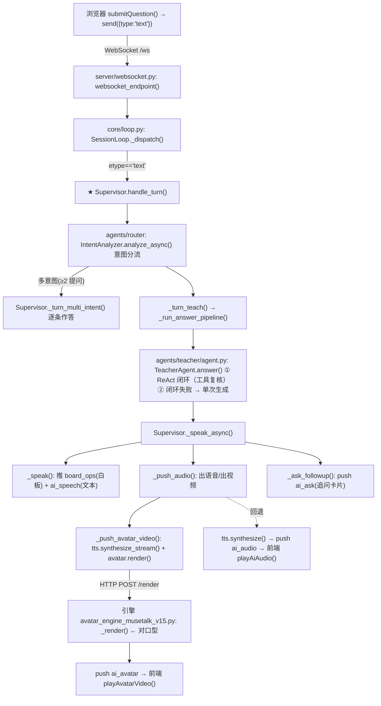

# 教育 AI 底座 · 代码地图（PROJECT_MAP）

> 目的：一页看懂**目录结构**、**哪些是核心代码**、以及**一次提问的端到端调用链**。
> 配合阅读：[`README.md`](README.md)（能力与部署）、[`本地开发联调.md`](本地开发联调.md)、[`算力云部署.md`](算力云部署.md)。

---

## 1. 目录树

```text
education/
├── .agents/                    # ★ 数字人教师技能（事实源：一科一份 Markdown）
│   ├── skills/<学科key>/SKILL.md   # ★ 风格 + 人格（运行期现读，改 md 即生效）
│   │                 └ references/ #   流派设计稿（人读，不注入提示词）
│   └── notes/                  # 设计稿与维护笔记（目录约定见 notes/README.md）
│
├── a2a/                        # ★ A2A（Agent2Agent）协议接入
│   ├── card.py                 # Agent Card（对外声明能力与调用入口）
│   ├── executor.py             # 把 Supervisor 回合包成 A2A Task（会话事件 → Artifact）
│   ├── rpc.py                  # JSON-RPC 2.0 分发（message/send · tasks/get · tasks/cancel）
│   ├── routes.py               # /.well-known/agent-card.json · POST /a2a
│   └── models.py · store.py · errors.py
│
├── agents/                     # 智能体（总调度 + 真正干活的执行者，四个角色全在这一包）
│   ├── base.py
│   ├── protocol.py             # ★ Agent 协作协议（角色 / AgentMessage / AgentBus 追踪）
│   ├── nodes.py                # ★ 流程节点注册表（四个角色的 Node 声明汇总 + 构建函数）
│   ├── supervisor/agent.py     # ★ 总调度 Agent（role=supervisor）：答疑/课件/追问/出语音视频
│   ├── supervisor/nodes.py     # 回合主流程 / 单页呈现 / 预取页呈现节点
│   ├── student/agent.py        # 学生端代理（麦控/设备状态）
│   ├── student/nodes.py        # 语音回合（ASR/回合/分发）+ 设备控制节点
│   ├── teacher/agent.py        # ★ AI 教师·答疑（讲题/图片题/白板/追问判定/出题判题）
│   ├── teacher/nodes.py        # 答疑流水线 / 判题流水线 / 出题流水线节点
│   ├── lecturer/agent.py       # ★ AI 讲课（课件逐页讲解 + 页面圈画标注，不写正文板书）
│   ├── lecturer/nodes.py       # 单页讲解 + 回退/兜底节点
│   └── shared/                 # mic_control.py(麦控) · whiteboard.py(白板)
│                               # ★ teaching_layers.py(共享提示词装配) · reply_parser.py(JSON 解析)
│
├── clients/                    # 客户端（前端）
│   ├── index.html              # 入口页
│   ├── student_tablet/index.html   # ★ 学生端（在用的主前端）
│   └── teacher_web/index.html  # 教师端 Web
│
├── config/                     # 配置
│   ├── settings.py             # ★ 全部配置（.env 映射）
│   ├── constants.py
│   └── logging.py
│
├── core/                       # ★ 核心编排
│   ├── loop.py                 # ★ 会话事件循环（WS 事件分发）
│   ├── harness.py              # ★ 全局装配（建会话/RAG/检查点/限流）
│   ├── router.py               # 意图路由（规则引擎）
│   ├── intent/                 # ★ 意图识别/分流决策层（analyzer 判定 + classifier 小模型）
│   ├── graph.py                # 自研 TaskGraph 编排
│   ├── langgraph_flow.py       # LangGraph 编排（可选）
│   ├── turn_graph.py           # 回合主图
│   ├── validator.py            # 回复校验
│   ├── guardrail.py            # 教学护栏/内容安全
│   ├── math_solver.py          # 数学求解/验算
│   ├── homework_mode.py        # 作业模式
│   ├── hint_homework.py        # 分层提示策略
│   ├── avatar_source.py        # AI 教师视频源解析/校验
│   ├── checkpoint.py           # 会话检查点（断线快照·只写未读）
│   ├── viseme.py               # 口型视素时间线
│   ├── resilience.py           # 韧性（重试/降级）
│   ├── anti_rev.py             # 防逆向/限流
│   ├── skills/                 # ★ teacher_personality/(学科人格，内容取自 .agents/skills/) ·
│   │                           #   experience/(Skill 自我更新经验层)
│   └── state/                  # models.py / session.py / store.py（会话状态）
│
├── models/                     # 模型客户端（脑/耳/口/脸）
│   ├── llm.py                  # Qwen3（大脑）
│   ├── asr.py                  # FunASR（听）
│   ├── tts.py                  # CosyVoice 3/2（说）
│   ├── avatar.py               # ★ 数字人客户端（含 Placeholder/Mock 降级）
│   └── base.py                 # 接口定义
│
├── server/                     # 服务入口
│   ├── app.py                  # ★ FastAPI 应用 / 路由挂载 / lifespan
│   ├── routes.py               # HTTP 路由（/api/*）
│   └── websocket.py            # ★ WebSocket 会话端点（/ws）
│
├── rag/retriever.py            # 轻量检索（教材/题库上下文）
├── document_parsing/           # ocr.py · pipeline.py（题目图→结构化）
├── mcp_tools/registry.py       # MCP 工具注册（math_solve/math_verify 等）
│
├── scripts/                    # 引擎与辅助脚本（多为独立进程/一次性工具）
│   ├── avatar_engine_musetalk_v15.py   # ★ 云端在用：MuseTalk 新 API（双底片）
│   ├── avatar_engine_musetalk.py       # MuseTalk 旧 API（保留）
│   ├── avatar_engine_wav2lip.py        # ★ 本机在用：Wav2Lip
│   ├── avatar_engine_local.py · avatar_adapter.py
│   ├── asr_engine_funasr.py            # FunASR 服务
│   ├── tts_engine_cosyvoice.py         # CosyVoice 2/3 服务
│   ├── start_local.ps1 · start_all.ps1 # 本机一键启动
│   ├── clear_cache.py · e2e_test.py · seed_data.py · download_models_local.py
│   └── prepare_avatar.py · preview_*.py · run_demo.py · demo_plan_a.py
│
├── deploy/                     # 部署
│   ├── Dockerfile · docker-compose.yml
│   └── cloud/                  # check_gpu.sh / setup.sh / download_models.sh /
│                               # start_all.sh(★) / stop_all.sh / env.cloud.example
│
├── data/                       # 数据（知识库 + 素材）
│   ├── ai_teacher/             # ★ 底片：talk/nod/shake/shrug/point/idle/眨眼睛.mp4
│   ├── curriculum · textbook · question_bank · error_patterns · teaching_materials
│   ├── avatar_clips/           # 备用形象片段
│   └── raw/                    # 运行时会话检查点（checkpoints/）
│
├── docs/                       # 设计与策略文档
│   └── supervisor_orchestration.md  # ★ 总控（Supervisor）调度策略：事件表/决策树/抢占/回退
├── tests/                      # 单测
├── README.md · 本地开发联调.md · 算力云部署.md · 代码地图.md（本文件）
└── requirements.txt · pyproject.toml · .env.example · .gitignore
```

> 已移除（无引用/按需废弃）：`db/`、`memory/` 两个包；体态检测相关（`models/vision.py`、`core/hint_policy.py`、`core/posture_graph.py`）及 `data/legacy/`、`data/raw/*.mp4`。

---

## 2. 核心代码分层

| 层 | 关键文件 | 职责 |
|---|---|---|
| 入口 | `server/app.py` · `routes.py` · `websocket.py` | HTTP/WS 接入 |
| 总控 | `core/harness.py` → `core/loop.py` → **`agents/supervisor/agent.py`**（本身就是 Agent：`role=supervisor`） | 装配 → 事件分发 → 会话闭环 |
| 决策 | **`core/intent/`** · `core/router.py` · `guardrail.py` · `validator.py` · `math_solver.py` | 意图识别分流/护栏/校验/验算 |
| 编排 | `core/graph.py` · `turn_graph.py` · `langgraph_flow.py` · `agents/nodes.py`（各角色 `agents/<角色>/nodes.py` 的流程节点） | 回合/答疑/讲课/麦控流水线 |
| 智能体 | **`agents/supervisor/agent.py`** · `agents/teacher/agent.py` · `agents/lecturer/agent.py` · `agents/student/agent.py` · `agents/shared/*` | 总控/答疑/讲课/麦控/白板 |
| 协作 | `agents/protocol.py` · `agents/shared/teaching_layers.py` | Agent 消息与追踪（可追溯） · 答疑与讲课共享的人格/风格装配 |
| 模型 | `models/llm.py` · `asr.py` · `tts.py` · **`avatar.py`** | 脑/耳/口/脸 |
| 支撑 | `rag/retriever.py` · `document_parsing/*` · `mcp_tools/registry.py` | 检索/OCR/工具 |
| 互操作 | `a2a/*` | A2A 协议接入（Agent Card 发现 + JSON-RPC 任务），供外部 agent 调用答疑能力 |
| 前端 | `clients/student_tablet/index.html` | 学生端 |
| 引擎 | `scripts/avatar_engine_*.py` · `asr_engine_funasr.py` · `tts_engine_cosyvoice.py` | 独立进程 |

**最关键的 5 个文件**：`agents/supervisor/agent.py`、`core/loop.py`、`core/harness.py`、`agents/teacher/agent.py`、`server/app.py`（＋前端 `clients/student_tablet/index.html`）。

### 2.1 智能体职责边界与协作

一次会话里的 agent 按**职责**切分（不是按学科 —— 学科差异由
`.agents/skills/<学科key>/SKILL.md` 一份 Markdown 承载：frontmatter 给风格/深度/语速，
正文小节给人格与九项教学行为，两层消费者同源读取）：

| Agent | 角色 | 负责 | 不负责 |
|---|---|---|---|
| `core.intent.IntentAnalyzer` | `router`（决策层，非 Agent） | 会话入口闸门：判意图、标「复杂/多意图」、决定是否转交下游 | 具体讲解内容、由谁执行 |
| `TeacherAgent` | `teacher` | 答疑：讲题、图片题、白板书写、追问判定、出题判题、课程问候 | 课件逐页讲解 |
| `LecturerAgent` | `lecturer` | 讲课：课件逐页讲解话术、本页要点、页面圈画/高亮标注 | 答疑、写正文板书、作业分层提示、追问判定 |
| `Supervisor` | `supervisor`（BaseAgent 子类，位置 `agents/supervisor/agent.py`） | 唯一持有会话状态：决定调用顺序、抢占、异常回退、写共享上下文 | 具体讲解内容 |
| `StudentAgent` | `student` | 学生端代理（麦控 / 设备状态） | — |

**调度策略全貌**（事件表 / 回合决策树 / 多意图策略 / 抢占与打断 / 失败回退 / 可观测性）：
见 [`docs/supervisor_orchestration.md`](docs/supervisor_orchestration.md)。

**调用顺序**（两条链路互不嵌套）：

```text
答疑：handle_turn → IntentAnalyzer.analyze_async → Supervisor._turn_teach
      → TeacherAgent.answer / answer_image / evaluate_answer → 白板 + 播报

讲课：handle_courseware / handle_slide_goto / _play_slides
      → Supervisor._explain_slide → LecturerAgent.explain_slide → 页面标注 → 换页 + 播报
```

**抢占规则**：讲课中学生提问 = 让位。`SessionLoop._barge_in` 自增 `speech_epoch`，
连讲在下一个页边界收工；这次转交由 `Supervisor._record_lecture_handoff()` 记录
（同一轮学生输入只记一次，用 `speech_epoch` 当轮次标识）。记录点放在 `_turn_teach`
入口 —— 它是内建编排与 LangGraph 主图**共同**的答疑入口，两套编排都不会漏。

**三种通信机制**（见 `agents/protocol.py`）：

1. **共享上下文**：`SessionState` 是唯一共享黑板（白板指令、课件页序、`history`、`scratch`），
   所有 agent 读写同一实例，不互相拷贝；
2. **消息传递**：agent 之间不直接互相调用，交互记成 `AgentMessage` 投到 `AgentBus`
   （`request` / `response` / `handoff` / `fallback` / `error`）；
3. **事件触发**：`AgentBus` 把消息扇出成客户端事件 `agent_message`，同时写进
   `session.scratch["agent_trace"]` 环形缓冲（上限 80 条），`AgentBus.trace(session)` 可取回。

**异常与回退**：

| 场景 | 处理 |
|---|---|
| 讲课 LLM 失败 / 返回非法 JSON | `LecturerAgent` 降级为「本页要点口播」，绝不哑巴翻页 |
| 讲课契约漂移（返回了答疑格式的 `steps`） | `_heal_points()` 从 steps 自愈出本页要点 |
| 讲课链路整体抛异常 | `Supervisor._explain_slide` 回退 `TeacherAgent.explain_slide`（等价实现），记 `fallback` |
| 回退也失败 | 记 `error` 并返回兜底话术 —— 不因为一页异常打断整节课 |

**提示词分层**（`agents/shared/teaching_layers.py`）：

* 共享层 = 身份基座 + 学科约束 + 讲课风格 + 老师人格 + 学科人格 + 经验层。
  答疑与讲课共用，保证「同一位老师」在两条链路上说话方式一致；
* 任务层 = 答疑契约 `ANSWER_CONTRACT` / 讲课契约 `LECTURE_CONTRACT`，各 agent 自持。
  拆分前两条链路的字段（`steps/answer/followup` 与 `points/annotations`）挤在同一个
  system 里互相打架，这是「讲 PPT 变成念 PPT」的根因；
* 层序越靠后影响力越强，因此讲课额外追加 `LECTURE_BOARD_OVERRIDE`，
  在学科人格**之后**覆盖其「白板组织」约定，避免把答疑式的分步板书带进课件讲解。

---

## 3. 端到端链路

### 3.1 一次「文字提问」全链路



### 3.2 关键函数定位（出视频 / 对口型）

| 环节 | 位置 | 说明 |
|---|---|---|
| 发请求 | `clients/student_tablet/index.html` `submitQuestion()` | `{type:'text', text}` 经 WS 发送 |
| 事件分发 | `core/loop.py` `_dispatch()` | `text` → `supervisor.handle_turn(...)` |
| 处理入口 | `agents/supervisor/agent.py` **`handle_turn()`** | 路由 → 答疑 / 追问作答 / 控制 / 闲聊 |
| 生成内容 | `agents/teacher/agent.py` **`answer()`** | 调 LLM 出 讲解+白板+followup |
| 播报 | `agents/supervisor/agent.py` `_speak_async()` | `_speak()`(白板/文本) + `_push_audio()` |
| **出视频** | `agents/supervisor/agent.py` **`_push_audio()` → `_push_avatar_video()`** | `if avatar.produces_video and await _push_avatar_video(...)`；逐句 `tts.synthesize_stream` |
| **触发渲染** | `models/avatar.py` `MuseTalkAvatar.render()` | **HTTP `POST {AVATAR_API_BASE}/render`**（audio/text/gesture/fps/bbox_shift） |
| **对口型** | `scripts/avatar_engine_musetalk_v15.py` **`_render(audio, out, gesture)`** | 音频→whisper 特征→UNet 重建嘴型→与底片融合（底片：`data/ai_teacher/talk.mp4`；问候用 `idle.mp4`） |
| 前端播放 | `index.html` `playAvatarVideo()` / `playAiAudio()` | 双缓冲交叉淡化 |

### 3.3 A2A 调用（外部 agent 接入）

```bash
# 1) 发现能力
curl http://127.0.0.1:8001/.well-known/agent-card.json

# 2) 发起任务（阻塞式）
curl -X POST http://127.0.0.1:8001/a2a -H 'Content-Type: application/json' -d '{
  "jsonrpc":"2.0","id":1,"method":"message/send",
  "params":{"message":{"role":"user","parts":[{"kind":"text","text":"这道方程题怎么解？"}]}}}'
# -> {"result":{"kind":"task","id":"task-…","contextId":"ctx-…","status":{"state":"completed"},
#              "artifacts":[{"name":"讲解话术","parts":[{"kind":"text","text":"…"}]},
#                           {"name":"白板板书","parts":[{"kind":"data","data":{"ops":[…]}}]}]}}

# 3) 取产物 / 取消
curl -X POST http://127.0.0.1:8001/a2a -H 'Content-Type: application/json' \
  -d '{"jsonrpc":"2.0","id":2,"method":"tasks/get","params":{"id":"task-…"}}'
```

状态机：`submitted → working → completed`；老师若留下追问则 `input-required`，
再发一条带同一 `taskId` 的消息即续跑同一任务（走既有判题链路）。
A2A 会话与前端 WS 会话隔离（session_id 前缀 `a2a-`），互不打断。
未实现 `message/stream`（流式）与 push notification，卡片里已如实声明。

### 3.4 教师 Skill 自我更新（经验沉淀）

```
答疑结束 → Supervisor._schedule_skill_reflection()  ──异步、fire-and-forget──┐
                                                                        ↓
   SkillReflector.reflect() 复盘本回合 → 提炼「可复用经验」 → ExperienceStore.observe()
                                                                        ↓
            data/teacher_experience/<老师key>.jsonl（append-only，可停用/回滚）
                                                                        ↓
   下次讲解 TeacherAgent._build_messages() 读经验 → 注入 system prompt（人格之后）
```

* **边界**：只追加「经验条目」，**不改写人格 Skill 本体**（`.agents/skills/**` 的 SKILL.md 永远由人维护）；
* **只记可复用经验**（换题换人仍成立），答案为 x=5 这类一次性的不记；空手而归是允许的；
* 去重（相似度 ≥0.85 累加 `hits`）、限流（每位老师默认最多 40 条，超出停用低分条目）；
* 运维接口：`GET /api/skills/experience?teacher=math` 查看、`POST /api/skills/experience/status` 停用/恢复；
* 经验目录**按环境隔离**（`sync_cloud.py` 已排除），本地与云端各自学习。

### 3.5 Agent 自主性四层（工具调用 / 自主规划 / ReAct 闭环 / 学情记忆）

详见 [`../docs/agent_autonomy.md`](../docs/agent_autonomy.md)。四条链路在代码里的位置：

```
课堂回合
   │
   ├─① 回合规划（core/planning/planner.py）
   │     Supervisor._resolve_plan(turn) → TurnPlan{goal, steps, tools, ask_followup}
   │     注入 context_notes；落 turn.meta["turn_plan"]；超时/关闭 → 规则计划
   │
   ├─② 答疑（agents/teacher/agent.py）
   │     TeacherAgent.answer() ── AGENT_REACT_ENABLE ──┐
   │                                                  ↓
   │        agents/teacher/react.py: ReActLoop.run()
   │          thought → chat_with_tools() → 工具调用 → observation → 再思考
   │          （最多 AGENT_REACT_MAX_STEPS 轮；步数用尽 tool_choice="none" 收尾）
   │                                                  │
   │        工具：agents/shared/toolkit.py —— knowledge_search / math_solve /
   │              math_verify / ocr_parse / read_board / whiteboard_note
   │              （前四个复用 mcp_tools.registry 的同一份实现）
   │                                                  │
   │        闭环失败（不支持工具 / 超时 / 异常）→ _answer_plain() 单次生成
   │
   └─③ 学情记忆（core/memory/）
         读：build_messages() → build_memory_prompt_for(session) → system 层
              （位置：共享人格层之后、教师经验之前）
         写：判题首次答错 → Supervisor._record_mistake_memory()（零 LLM 成本）
             答疑结束   → _schedule_memory_distill()（异步，默认关闭）
         → data/memory/students/<student_id>.jsonl（append-only，可按学生删除）
```

* **四层全部可单独关闭**（`AGENT_TOOLS_ENABLE` / `AGENT_REACT_ENABLE` /
  `AGENT_PLANNER_ENABLE` / `MEMORY_ENABLE`），全关即回到「单次生成 + 规则分流」的原始链路；
* **与流式的取舍**：ReAct 开启时 `_turn_teach` 不走并行流式话术（否则模型还在调工具、
  话术已经播出去了），详见 `docs/agent_autonomy.md` §3；
* **记忆与经验正交**：经验按**老师**存（老师怎么讲更有效），记忆按**学生**存
  （这位学生哪儿不会），后者物理隔离，绝不跨学生复用。

---

## 4. 运行时端口（云端全栈）

| 服务 | 端口 | 说明 |
|---|---|---|
| 主应用（FastAPI） | 8001 | HTTP + `/ws` |
| Qwen3（vLLM） | 8100 | 大脑 |
| FunASR | 10095 | 语音识别 |
| CosyVoice 3 | 8090 | 语音合成（2/3 自动挑版本） |
| MuseTalk 引擎 | 8012 | 数字人（云端，新 API） |
| Wav2Lip 引擎 | 8011 | 数字人（本机） |

启动：云端 `bash deploy/cloud/start_all.sh`；本机 `scripts/start_local.ps1`。
公网分享：`cloudflared tunnel --url http://127.0.0.1:8001`（见 `算力云部署.md`）。
